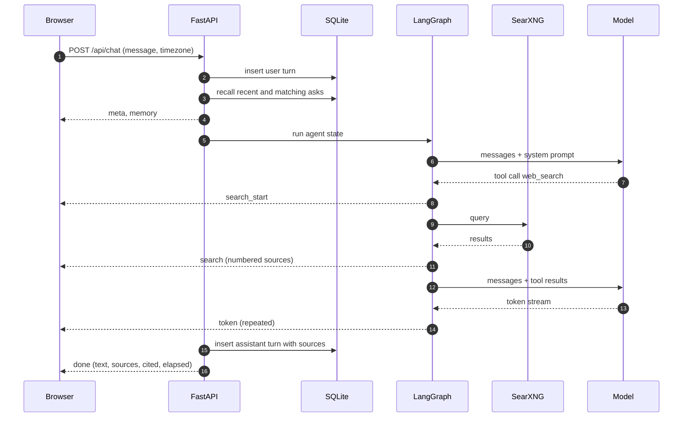

# Askline

Askline is a small chat agent that answers from the web and keeps a timestamped record of
what you asked it. It has exactly one tool, web search, and one job: give a fast, cited
answer, then remember the question and the time it arrived.

The app is a FastAPI service, a LangGraph agent, a SQLite file, and a single-page
interface. Every model call goes through an OpenAI-compatible or Anthropic-compatible
endpoint, so the choice of provider is configuration rather than code. The whole stack
runs with one command through Docker Compose or Podman Compose.

## Why the constraints are the design

A general chat agent accumulates tools and branches until its behaviour is hard to
predict. This one keeps a single tool because the interesting problems sit elsewhere: a
search result has to reach the model intact, a citation has to point at a real page, and
the record of a question has to survive the session that asked it.

Three properties follow from that choice.

The common turn is one model call. A search adds one HTTP round trip and a second model
call, and the loop stops after two search rounds. The stream emits its first event before
any model work starts, so the interface reacts immediately.

The model may only cite pages it received. Every result set is numbered, the prompt
requires `[n]` markers that map to those numbers, and citations outside the retrieved
range are removed before the answer is stored. A page that was never retrieved cannot
appear as a source.

Memory is a log, not a summary written by the model. Every user question is written with
a UTC timestamp, and recall reads the log directly. The model is handed the six most
recent questions plus any earlier questions that match the current wording, each with its
local time, so "what did I ask about Postgres last week" can be answered from the record
rather than from the model's impression of it.

## What a turn looks like



The agent is a three-node LangGraph state machine: `agent`, `collect`, and the tool node.
`agent` decides whether to search. The tool node calls one function, `web_search`.
`collect` merges the results, removes duplicates by URL, and renumbers the source list so
the citation numbers the model sees are the numbers the browser receives. When the round
cap is reached, the model is bound without tools, which forces an answer instead of a
third search.

## Memory, including the time

Two tables carry the feature. `turns` is the append-only transcript. `asks` is an FTS5
index over the user half, written in the same transaction as the turn, so the transcript
and the recall index cannot disagree. Ordering uses SQLite `rowid` so two questions in the
same second still sort predictably.

Recall merges two sets. The last six questions are always included, because a history
question often shares no words with the question it asks about. The rest come from an
FTS5 match on the current wording with stop words removed and Porter stemming applied.
The merged list is capped at 1,600 characters and formatted for the prompt.

```
MEMORY (the user's earlier questions, with local time)
- 2026-11-10 19:03 (today) Compare Postgres logical and physical replication
- 2026-11-10 19:01 (today) What changed in the latest Python release?
- 2026-11-03 09:12 (7 days ago) cheap flights to Lisbon in March
```

The zone comes from the browser with each request (`Intl.DateTimeFormat`), because a
container's clock is UTC even when the person using it is not. Without that value the
model reported a 19:04 question as 13:04. `AGENT_TZ` remains the fallback for API clients,
and an unknown zone is rejected at the boundary rather than silently rendered wrong.

A vector store was considered and rejected. The corpus is one person's questions, the
vocabulary is narrow, and FTS5 lives in the same file as the log. If recall quality
becomes the limit, `Store.recall` is the only method that needs to change.

## Search

SearXNG is the primary backend. It aggregates engines server-side and returns JSON, so
the app makes one local HTTP request and receives a ranked list. The compose stack runs
it beside the app and publishes it on `127.0.0.1` only.

If the instance is down, returns an error, or returns nothing relevant, the same search
call falls through to public result pages.

| Backend | How it is read | Role |
| --- | --- | --- |
| SearXNG | `results[]` from `format=json` | Primary, one local hop |
| Bing | `li.b_algo`, `h2 a`, `p` | First fallback; redirect links decode from `u=a1` |
| DuckDuckGo HTML | `.result`, `a.result__a` | Independent index; links decode from `uddg` |
| Mojeek | `ul.results-standard li` | Last fallback |

Results are deduplicated by host and path, internal engine links are dropped, and six
survive. A result must also share a distinctive word with the query. That filter exists
because Bing answered "latest LangGraph release" with unrelated television news: the word
"latest" alone was enough for a match. Filtered results let the next backend try instead
of feeding noise to the model.

Results are cached in SQLite for ten minutes. A follow-up question reuses the pages it
already retrieved, and a question about today does not keep stale pages for long. A cache
hit is labelled in the stream.

## Run it

Prerequisites are Docker or Podman with a Compose provider. Podman on macOS needs a
running machine; `podman machine start` is enough.

```sh
cp .env.example .env
# set LLM_API_KEY and LLM_MODEL in .env
./run.sh up
```

`run.sh` builds the image, starts the app and SearXNG, waits for the health endpoint, and
prints the address. Open <http://localhost:8000>. `./run.sh open` opens it for you on
macOS or a desktop Linux session.

To stop the stack, run `./run.sh down`. Logs are available with `./run.sh logs`.

### Run it on another machine

Copy the checkout to the host and run the same command there. The only value that must
change is `LLM_BASE_URL`: it has to be an address the host can reach, not `localhost`,
because the model endpoint is called from inside the container. A model on your laptop is
reachable at the laptop's LAN address, for example
`http://192.168.1.32:11434/v1` for Ollama, provided Ollama listens beyond loopback.

```sh
tar czf - --exclude .venv --exclude data --exclude .env . \
  | ssh root@server 'mkdir -p /opt/askline && tar xzf - -C /opt/askline'
ssh root@server 'cd /opt/askline && ./run.sh up'
```

The app then answers at `http://server:8000`. SearXNG stays bound to the server's
loopback, and the app publishes its port on all interfaces, so that URL works from the
LAN. The SQLite volume lives on the server, which means the memory survives restarts
there independently of the laptop.

The same command works with Docker Compose when Docker is installed. The script prefers
`docker compose`, then `podman compose`, then `podman-compose`, so the same checkout runs
on either engine without edits.

### Point it at a model

Askline talks to any endpoint that implements the OpenAI chat-completions API or the
Anthropic messages API. Pick one of the following and put the values in `.env`.

| Endpoint | `LLM_PROVIDER` | `LLM_BASE_URL` | Notes |
| --- | --- | --- | --- |
| OpenAI | `openai` | `https://api.openai.com/v1` | Default base URL |
| Anthropic | `anthropic` | `https://api.anthropic.com` | Default model `claude-sonnet-4-5` |
| OpenRouter | `openai` | `https://openrouter.ai/api/v1` | Any routed model id |
| Ollama on the host | `openai` | `http://host.docker.internal:11434/v1` | Any API key value; the model must support tools |
| Ollama on Linux | `openai` | Host LAN address, port 11434 | `host.docker.internal` is not automatic on Linux |

Provider, base URL, model, temperature, and token limit can also be changed while the app
runs, from Settings. Those values are stored in SQLite and override the environment for
later turns. The API key stays masked when read back.

## Configuration

| Variable | Default | Purpose |
| --- | --- | --- |
| `LLM_PROVIDER` | `openai` | `openai` or `anthropic` |
| `LLM_BASE_URL` | provider default | Compatible endpoint root |
| `LLM_MODEL` | provider default | Model id sent to the endpoint |
| `LLM_API_KEY` | empty | Required before chat works |
| `LLM_TEMPERATURE` | `0.2` | Sampling temperature |
| `LLM_MAX_TOKENS` | `800` | Answer ceiling |
| `AGENT_TZ` | `local` | Fallback IANA zone for API clients |
| `DATA_DIR` | `./data` | Directory holding `chat.db` |
| `SEARXNG_URL` | empty | Enables the SearXNG path when set |
| `SEARXNG_PORT` | `8088` | Host port for the search service |
| `PORT` | `8000` | Host port for the app |

The SQLite file is the only state. Back it up by copying `data/chat.db` while the app
is stopped, or by copying the `askline-data` volume. The database uses WAL mode, so a
cold copy of the directory is safer than copying the file under load.

## HTTP interface

| Method and path | Purpose |
| --- | --- |
| `GET /` | The interface |
| `GET /api/health` | Provider, model, search backend, SearXNG reachability |
| `GET /api/settings` | Public configuration, key masked |
| `POST /api/settings` | Save provider, endpoint, model, sampling, and optionally a key |
| `POST /api/settings/test` | One completion against submitted or stored settings |
| `GET /api/models` | Model ids from the endpoint's model list |
| `GET /api/threads` | Thread list with turn counts |
| `POST /api/threads` | New thread |
| `GET /api/threads/{id}` | Thread and full turn history with sources |
| `DELETE /api/threads/{id}` | Delete a thread and its turns |
| `GET /api/timeline` | User questions grouped by local day |
| `POST /api/chat` | SSE turn stream |

`POST /api/chat` accepts `message`, optional `thread_id`, and optional `timezone`. The
response is `text/event-stream` with these events.

| Event | Carries |
| --- | --- |
| `meta` | `thread_id`, `turn_id`, `created_at`, `model`, `provider` |
| `memory` | Recalled questions with UTC and local time |
| `search_start` | The query sent to search |
| `search` | Numbered results, backend, cache flag, error |
| `token` | One text delta |
| `done` | Final text, sources, cited numbers, elapsed milliseconds |
| `error` | A message for the interface |

The turn is stored only after `done`. A disconnected stream leaves the user question in
the log and no assistant answer beside it.

## Develop

Python 3.11 or newer is required. The container uses 3.12.

```sh
python3 -m venv .venv
.venv/bin/pip install -r requirements-dev.txt
.venv/bin/python -m uvicorn app.main:app --reload
```

Or use `make install` and `make dev`. The test suite needs no network and no model:

```sh
make test
```

The suite replaces the chat model with a scripted `BaseChatModel` and feeds the search
engine an `httpx.MockTransport`, so routing, the two-round cap, source merging, citation
filtering, SSE framing, persistence, caching, settings, and the memory block are exercised
through the real application. Saved Bing and DuckDuckGo markup keeps the parser tests
honest about page structure. The current suite has 37 tests.

A live check still matters. Point the app at a real endpoint, ask a question that needs
today's web, and confirm that the answer cites a page whose snippet supports it. Then ask
"what did I ask earlier, and at what time" in a new thread and compare the time with your
clock.

## Measured behaviour

These numbers come from the development machine, a local `gemma4:e2b` endpoint, and the
SearXNG container. The model is small and slow; the app's own stages are the first two
rows.

| Stage | Time |
| --- | --- |
| SSE headers and `meta` | 0.18 s |
| SearXNG search, six results | 2.4 s |
| Model decides to call the tool | 10.0 s |
| First token | 23.2 s |
| Turn complete | 25.1 s |

The app controls one search in the common case, a two-round cap, a ten-minute cache, and
a stream that starts before model work. The model endpoint accounts for most of the
measured latency. A hosted endpoint should reduce it, but that is an expectation rather
than a measurement from this machine.

The deployment path was verified with Podman and its Compose provider. `./run.sh up`
built the image, started both containers, passed the health check, served the interface,
and answered a real chat turn through the container with six SearXNG results and valid
citations.

## Layout

```
app/
  main.py       FastAPI routes, SSE endpoint, settings validation
  agent.py      turn orchestration and event stream
  graph.py      LangGraph state machine, prompt, tool binding
  llm.py        provider factory, connection test, model list
  search.py     SearXNG and fallback parsers, relevance filter, cache
  memory.py     SQLite schema, transcript, FTS5 recall, timeline
  citations.py  citation parsing and invalid marker removal
  schemas.py    shared records
  static/       one HTML page, one stylesheet, one script
tests/          pytest suite with model and transport seams
design.md       the full design and its rejected alternatives
searxng/        search service configuration
```

## Limits

The scraped fallbacks are best-effort. Search engines change markup and block clients,
and the parsers will need occasional attention; SearXNG is the path built for stability.
SearXNG itself can be rate-limited by the engines it queries.

The app has no authentication. Run it on localhost, or on a network you already trust.
The compose stack publishes the app on all interfaces and SearXNG on localhost only.

Memory is per database, not per user. One instance serves one person's history, which
matches the intended deployment.

The README's timing table measures a small local model. It is evidence about where time
goes, not a claim about how fast a hosted model will answer.

## Design notes

`design.md` records the data model, the graph states, the streaming contract, the failure
modes, the alternatives that were considered and why they were rejected, and the limits
above. Read it before changing the agent loop or the memory schema.
