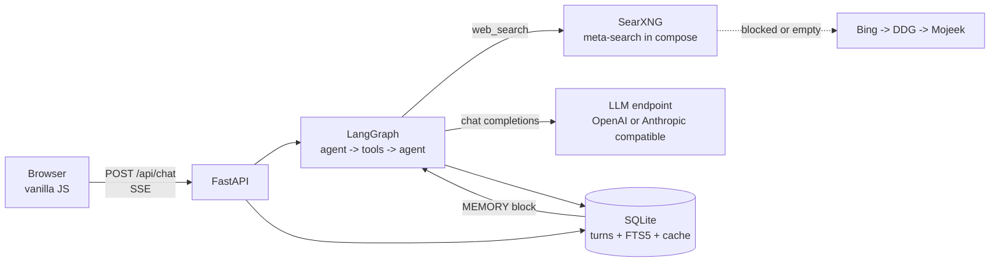
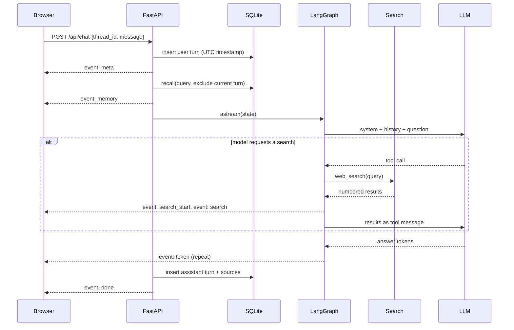

# Askline design

Askline is a chat agent with exactly one tool: web search. It answers questions in a
streaming column, cites the pages it used, and keeps a timestamped record of every
question the user asks so a later question such as "what did I ask about Lisbon last
week" can be answered from that record.

The design favours three properties over feature count:

1. **Speed.** The common turn is one model call. A search adds one HTTP round trip and
   a second model call, not an open-ended agent loop.
2. **Correctness.** The model may only use the search results it received, and every
   claim taken from a result is expected to carry that result's number. Numbers that do
   not map to a retrieved source are stripped before the answer is stored or shown.
3. **Memory.** Every user question is written to an append-only log with a UTC
   timestamp. Recall reads that log, not a summary written by the model.

## Goals and non-goals

The primary user is one person running the app on a laptop or a small server, talking to
whichever model endpoint they already pay for. The app should be openable in one command
and should not require an account, a vector database, a message queue, or a build step.

Non-goals: multi-user accounts, document upload and retrieval, autonomous multi-step
tasks, code execution, and long-running background work. One tool is a constraint, not a
starting point.

## System shape



The browser holds no state that matters. Threads, turns, sources, and settings live in
SQLite, so a refresh or a second tab reconstructs the same view. The model is stateless:
the graph is compiled without a checkpointer, and each turn rebuilds its message list
from the log. This removes a class of bugs where a checkpoint and the visible transcript
disagree.

## A turn, end to end



A turn is capped at two search rounds. The cap is enforced in two places: the routing
edge stops sending the model back to the tool node, and the agent node stops binding
tools once the cap is reached, so the model must produce a final answer from what it has.
This bounds latency and cost at roughly three model calls and two searches in the worst
case.

## Data model

```
threads(id, title, created_at, updated_at)
turns(id, thread_id, role, text, created_at, sources_json)
asks  -- FTS5 over user turn text with turn_id, thread_id, created_at
search_cache(key, payload, created_at)
settings(key, value)
```

`turns` is append-only. `asks` is a materialised index of the user half, written in the
same transaction as the turn, so recall and the transcript cannot drift. Ordering uses
SQLite `rowid` rather than the second-resolution timestamp, because two turns in the same
second must still have a stable order.

The `sources_json` column keeps the exact result set that was shown to the model with
that answer. Reopening a thread therefore reproduces the citations, even though the
search cache may have expired.

## Why SearXNG, with a scraped chain behind it

A search API key would add a second credential to configure and a vendor to trust. A
self-hosted SearXNG instance avoids both: it aggregates several engines server-side,
returns JSON, and runs as one more container beside the app. The service is published
only on `127.0.0.1`, so the instance is not an open proxy.

The app queries `SEARXNG_URL` first. If the instance is unreachable, returns an error,
or returns no relevant result, the same `SearchEngine.search` call falls through to the
public result pages of three engines, in order:

| Engine | Parser | Why it is in the chain |
| --- | --- | --- |
| SearXNG | `results[]` from `format=json` | Primary path; one local HTTP hop, six results, no vendor key |
| Bing | `li.b_algo`, `h2 a`, `p` | Most reliable public HTML at the time of writing; redirect links decode from `u=a1<base64url>` |
| DuckDuckGo HTML | `.result`, `a.result__a` | Independent index; redirect links decode from `uddg=` |
| Mojeek | `ul.results-standard li` | Third fallback when the first two are blocked |

Each result is normalised to title, URL, snippet, and backend. Results are deduplicated
by host plus path, internal engine links are dropped, and the first six survive. A
result also has to share a distinctive word with the query; filler such as "latest" was
enough for Bing to return unrelated news, so `relevant()` filters those pages and lets
the next backend answer. A miss is not fatal: the tool returns an error payload, the
model is told the search failed through that payload, and the answer can say so. Every
backend failing produces one `search` event with an `error` field rather than an
exception.

The cache is keyed by a hash of the normalised query and result count. Its TTL is ten
minutes, which is long enough that a follow-up question reuses the same pages and short
enough that "today" questions do not go stale. Cache hits are labelled `cached: true` in
the stream.

## Memory

Memory answers two different questions, and the implementation treats them differently.

*What did I ask, and when?* is a property of the log. The `MEMORY` block always includes
the six most recent asks with their local timestamps, regardless of the current query.
The model is instructed to answer history questions from that block with the dates as
written.

*What did I say about X?* is a retrieval problem. The current query is tokenised, stop
words are dropped, and the remaining terms are OR-ed into an FTS5 match over all user
turns. Porter stemming makes "install" match "installed". The top matches are merged with
the recent six, deduplicated, sorted newest first, and cut to a 1,600 character budget.

The current turn is excluded explicitly. Without that exclusion the newest ask is always
the question being answered, and it crowds out the history the model is meant to recall.

The block that reaches the model looks like this:

```
MEMORY (the user's earlier questions, with local time)
- 2026-11-10 14:32 (today) How do I install LangGraph on Python 3.12?
- 2026-11-09 21:04 (yesterday) What changed in LangGraph 1.0?
- 2026-11-03 09:12 (7 days ago) cheap flights to Lisbon in March
```

Timestamps are stored in UTC and rendered in an IANA zone supplied by the browser with
each chat request. `AGENT_TZ` remains the fallback for API clients. The browser value
matters because a container's own clock is UTC even when the host is not: without it the
model told a user in IST that their 19:04 question arrived at 13:04. An unknown zone is
rejected at the API boundary with a 400 rather than silently falling back.

Chromium reports `Asia/Calcutta`, a legacy alias that current tzdata builds no longer
ship as a file. The image installs the `tzdata` Python package, whose backward links
cover those names, so the alias resolves instead of failing the whole turn. That failure
was observed in the browser and is why the dependency is explicit rather than assumed.

A vector store was rejected. The corpus is one person's questions, the vocabulary is
narrow, and FTS5 runs in the same file as the log with no extra service. If recall
quality becomes the bottleneck, the `recall` method is the only thing that needs to
change.

## The graph

State:

| Field | Purpose |
| --- | --- |
| `messages` | LangChain messages, reduced with `add_messages` |
| `system` | The prompt built for this turn, including the memory block and local date |
| `sources` | Deduplicated, renumbered results accumulated across rounds |
| `rounds` | Completed search rounds, used by the cap |
| `handled_tools` | Tool call ids already parsed, so a replayed state cannot double count |

Nodes are `agent`, `tools`, and `collect`. `collect` parses the tool message JSON into
`sources` and increments `rounds`; keeping it separate means the tool node stays a plain
`ToolNode` and the parsing is testable on its own.

The model is built per request from the effective settings. That is cheap, and it means
a settings change applies to the next message without a restart.

## Provider abstraction

`ChatConfig` is the single boundary. It resolves, in order: values saved from the
settings dialog, then environment variables, then defaults. `build_chat_model` maps the
provider name to `ChatOpenAI` or `ChatAnthropic`, both of which accept a `base_url`, a
model id, a key, and tool definitions.

That covers OpenAI, Anthropic, OpenRouter, Groq, Together, Fireworks, vLLM, LM Studio,
and Ollama's OpenAI-compatible endpoint. A provider that speaks a different wire format
needs a new branch in one function, not changes to the graph, the memory, or the UI.

Keys saved through the UI are stored in the `settings` table in plain text. This is a
local single-user app, and the alternative, an OS keychain, would not work in a
container without extra plumbing. The key is never returned to the browser: the settings
endpoint reports `has_api_key` only.

## Streaming contract

`POST /api/chat` returns `text/event-stream`. Frames are `event: name\ndata: json\n\n`.

| Event | Payload | Consumer behaviour |
| --- | --- | --- |
| `meta` | thread_id, turn_id, created_at, model, provider | Bind the answer to a thread, show the model |
| `memory` | items with text, created_at, local_time | Show that recall happened |
| `search_start` | query | Show "Searching the web..." |
| `search` | results, cached, backend, error | Render source chips |
| `token` | delta | Append to the answer |
| `done` | text, sources, cited, elapsed_ms | Finalise, show sources and timing |
| `error` | message | Inline error with retry |

The stream is produced with `graph.astream(..., stream_mode=["messages", "updates"])`.
`messages` carries token chunks; `updates` carries node outputs, which is where tool
results appear. That pairing gives live tokens and structured search events from the same
run without a second model call or a callback side channel.

## Answer shaping

The system prompt fixes the shape of the answer: lead with the answer, then the
supporting facts, four to eight sentences, no preamble. It also states the current local
date and time, which prevents "latest" questions from being answered against an old
training cut-off, and it makes the memory rule conditional on a memory block existing.

Citation handling is deliberately strict. The browser links `[n]` to result `n` only when
that result exists. `strip_invalid` removes numbers outside the retrieved range before
the answer is stored. The stored text and the rendered text therefore agree, and a model
that invents `[7]` with six sources leaves no dead link behind.

## Failure modes

| Failure | Behaviour |
| --- | --- |
| No API key | The chat endpoint returns 400 with a message that names Settings |
| Model endpoint down | SSE `error` event; the user turn stays in the log |
| All search backends blocked | Tool returns an error payload; the model is told and can say what is unknown |
| Model times out | 120 second turn timeout, then an SSE `error` |
| Model returns no text | SSE `error` names the empty answer, no assistant turn is stored |
| Stream disconnects | The async generator closes; the turn is not stored unless `done` ran |
| SQLite locked | Ten second busy timeout; each operation uses its own connection |

## Testing

The test suite runs without a model and without the network. Two seams make that
possible:

* `build_chat_model` is replaced with `ScriptedModel`, which returns a fixed sequence of
  `AIMessage` objects, including tool calls. Graph routing, the search cap, source
  merging, SSE framing, and persistence are all exercised through the real FastAPI app.
* `SearchEngine` accepts an `httpx` transport. `MockTransport` serves saved Bing and
  DuckDuckGo markup, so parser and fallback behaviour are tested against real page
  structure, and the cache path is tested without waiting for a network.

The live checks that the suite cannot replace are a real model call, a real search, and a
browser turn. Those are run manually and recorded in the README.

## Verification

Measured on the development machine with a local `gemma4:e2b` endpoint (a small model,
chosen because it was reachable), a browser-shaped chat request, and the SearXNG
container. The model dominates the total; the app's own stages are the first row and the
search round trip.

| Stage | Time |
| --- | --- |
| SSE headers and `meta` event | 0.18 s |
| SearXNG search, six results | 2.4 s |
| Model decision to call the tool | 10.0 s |
| First streamed token | 23.2 s |
| Complete turn, `done` event | 25.1 s |

The latency choices in the design are the ones the app controls: one search round in the
common case, a two-round cap, a ten-minute result cache, and a stream that emits `meta`
before any model work starts. A hosted model endpoint removes most of the measured time;
that is an expectation, not a measurement.

The test suite covers the graph, parsers, cache, API, citations, and memory without a
model or network. The container run is verified separately with `./run.sh up`, a health
check, a SearXNG JSON request, and one real chat turn.

## Rejected alternatives

* **LangChain's `AgentExecutor`.** Its loop is unbounded and its intermediate steps are
  harder to stream as typed events. A three-node `StateGraph` is smaller and predictable.
* **A LangGraph checkpointer.** It would duplicate the transcript that SQLite already
  holds. One source of truth is easier to reason about and to query for memory.
* **A frontend framework and bundler.** The UI is one page and one stream. A build step
  would add tooling and a deploy artifact for no user-visible gain.
* **A search API with a key.** It would improve result quality slightly and cost setup
  friction, a second secret, and a vendor dependency. The chain is good enough and can
  be replaced behind `SearchEngine.search`.
* **HTMX or server-rendered fragments.** Token streaming and a memory drawer need
  client state. Vanilla JS is smaller than either framework at this size.
